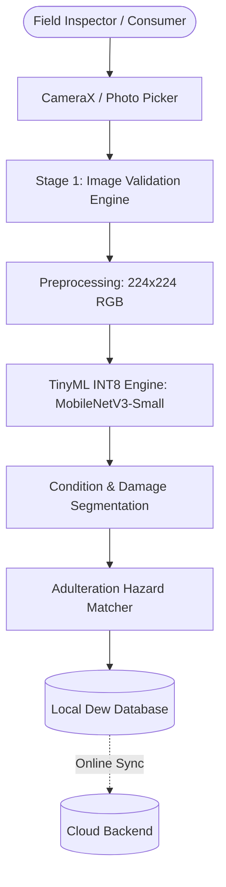

# Dew Computing Framework Architecture

## Title
**A Lightweight TinyML-Based Dew Computing Framework for Offline and Low-Latency Food Adulteration Detection**

---

## 1. Executive Summary

Dew computing represents an evolution beyond Cloud and Fog computing by enabling edge sensor nodes to function as self-contained micro-servers. In NutriScan AI, edge smartphones execute:
- Local optical capture and tensor preprocessing
- On-device INT8 quantized MobileNetV3 inference (<50ms latency)
- Local transactional SQLite persistence
- Delayed, idempotent synchronization with the centralized cloud.

---

## 2. Nine-Stage Pipeline Specification

1. **Stage 1: Image Validation**: Verifies luminance ($18 \le L \le 250$ nits) and Laplacian edge sharpness ($\ge 2.5$).
2. **Stage 2: Object Detection**: Confirms presence of organic food targets vs non-food artifacts.
3. **Stage 3: Category Identification**: Maps chromatic profiles across 78 registered commodities in 6 groups.
4. **Stage 4: Visible Condition & Damage Assessment**: Segments bruised, necrotic, and moldy surface regions to calculate exact Damage Percentage.
5. **Stage 5: Supported Adulteration Screening**: Evaluates chemical hazard indicators (e.g. Metanil Yellow in Turmeric, Sudan Red in Chilli, Detergent in Milk).
6. **Stage 6: Uncertainty & Confidence Filter**: Rejects low-confidence inferences and enforces safety disclaimers.
7. **Stage 7: Multi-Card Display**: Organizes results into clear stages with edibility status and measured timing.
8. **Stage 8: Local Dew Persistence**: Commits records to local SQLite with `PENDING` sync status.
9. **Stage 9: Dew-to-Cloud Sync**: Performs idempotent batch uploads when internet connectivity is re-established.
