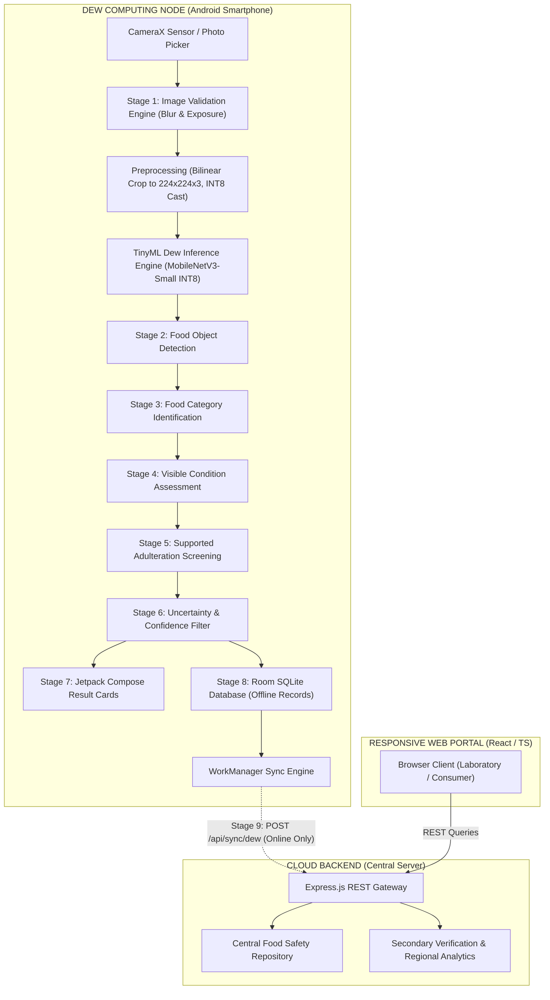
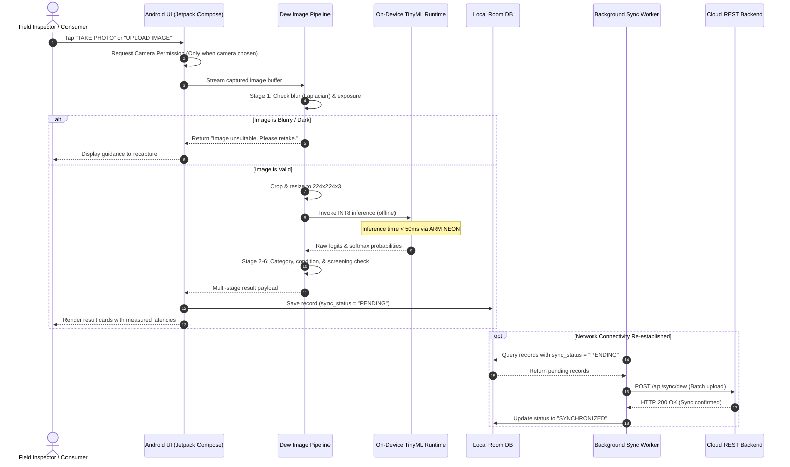

# Dew Computing Framework Specification

## Project Title
**A Lightweight TinyML-Based Dew Computing Framework for Offline and Low-Latency Food Adulteration Detection**

---

## 1. Architectural Philosophy

Traditional distributed systems rely on Cloud Computing (centralized servers) or Fog Computing (localized edge gateways). However, in field food safety inspections (e.g., rural mandis, local grocery markets, transit warehouses), network connectivity is frequently intermittent or non-existent.

**Dew Computing** positions the mobile edge device (Android smartphone) as a **fully self-reliant, autonomous micro-server**. The device executes:
1. Optical image acquisition and real-time quality validation.
2. Tensor preprocessing and quantization mapping.
3. On-device TinyML deep neural inference using embedded ARM NEON hardware acceleration.
4. Local persistence in a transactional Room database.
5. Delayed, idempotent telemetry synchronization whenever network connectivity becomes available.

---

## 2. System Architecture Diagram

---

## 3. End-to-End Sequence Diagram

---

## 4. Dew Sync State Machine

Every scan record in the local database maintains one of three explicit sync states:
- `PENDING`: Saved locally on device; awaiting network connectivity or user consent.
- `SYNCHRONIZED`: Confirmed received by the cloud backend with matching server UUID.
- `FAILED`: Synchronization attempted but rejected or timed out; queued with exponential backoff.

### Privacy & Consent Protection
In accordance with consumer privacy standards, scan records are **never uploaded automatically by default**. Users must toggle "Enable Cloud Sync" in Settings, ensuring local on-device screening remains completely private.
